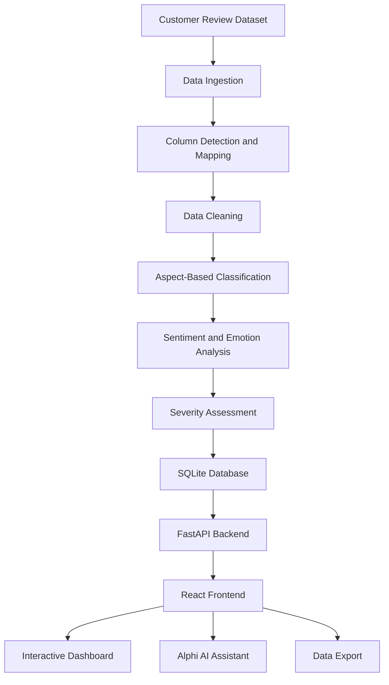
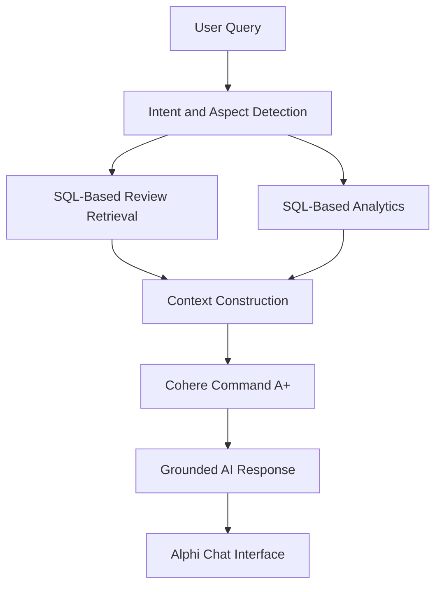

# ⚡ AlphaEV
### Explainable AI-Powered EV Charging Review Intelligence Platform

AlphaEV is an AI-powered review intelligence platform designed to transform unstructured Electric Vehicle (EV) charging-station customer reviews into meaningful, structured, and actionable insights.

The platform combines Natural Language Processing (NLP), Machine Learning, sentiment analysis, and explainable predictions to analyze customer feedback across 11 EV charging-related aspects.

It identifies positive and negative opinions, analyzes customer emotions, detects potential safety and operational issues, and prioritizes critical complaints using a severity-first assessment approach.

With interactive analytics dashboards and **Alphi**, an AI-powered conversational assistant, AlphaEV enables users to explore customer feedback, identify recurring problems, and gain data-driven insights into EV charging experiences.

---

## 🎬 Project Demonstration

Explore AlphaEV through a complete application walkthrough available on my portfolio.

**[▶ Watch the AlphaEV Project Demo](https://myportfolio-ten-pi-28.vercel.app/projects/alphaev)**

---

## 📌 Problem Statement

The growing adoption of electric vehicles has increased the importance of reliable and accessible EV charging infrastructure.

Customer reviews contain valuable information about charging experiences. However, manually analyzing large volumes of unstructured feedback makes it difficult to identify recurring problems, understand customer sentiment, and prioritize critical issues.

Traditional review analysis often overlooks:

- Specific aspects of the charging experience being discussed.
- Whether customer feedback is positive or negative.
- The emotions expressed in customer reviews.
- Critical safety-related complaints requiring immediate attention.
- Recurring operational issues affecting customer satisfaction.

**AlphaEV addresses these challenges** through an automated review intelligence pipeline that processes customer feedback, identifies meaningful patterns, and presents the results through an interactive analytical interface.

---

## ✨ Key Features

### 1. Dataset Ingestion
- Upload customer review datasets in CSV and Excel formats.
- Automatically detect available columns.
- Suggest column mappings for review text, ratings, dates, sources, and reviewer information.
- Preview uploaded data before processing.
- Support review ingestion through an API endpoint.

### 2. Intelligent Data Cleaning
- Remove HTML tags and unnecessary URLs.
- Repair common text encoding issues and corrupted characters.
- Detect exact and near-duplicate reviews.
- Identify empty and low-information reviews.
- Detect language information and maintain data-quality flags.
- Preserve original review text alongside cleaned review content.

### 3. Aspect-Based Classification
- Identify customer feedback across 11 EV charging-related aspects.
- Classify detected aspects into positive and negative polarity.
- Use TF-IDF vectorization and One-vs-Rest Logistic Regression.
- Apply domain-specific keyword matching as a fallback when the model does not produce confident predictions.
- Generate confidence scores for predictions.
- Support manual correction of classification results.

### 4. Sentiment and Emotion Analysis
- Classify overall review sentiment into:
  - Positive
  - Negative
  - Neutral
- Identify customer emotions across five categories:
  - Happy
  - Sad
  - Frustrated
  - Satisfaction
  - Neutral
- Use rule-based text analysis with keyword matching and negation handling.
- Support human correction of sentiment and emotion labels.

### 5. Explainable Predictions
- Provide feature-level explanations for classification results.
- Identify influential words from review text.
- Use TF-IDF feature values and Logistic Regression coefficients to calculate word contributions.
- Display terms associated with individual aspect predictions.

### 6. Severity-First Issue Prioritization
- Detect potential safety hazards and operational problems using a predefined hazard taxonomy.
- Evaluate issue severity using hazard patterns and evidence confidence.
- Assign severity levels:
  - Critical
  - High
  - Medium
  - Low
- Generate priority scores for detected issues.
- Group related problems into actionable issue clusters.
- Preserve supporting evidence and verification status.
- Highlight potentially serious safety-related complaints instead of relying only on complaint frequency.

### 7. Interactive Analytics Dashboard
- Visualize review and dataset statistics.
- Explore aspect-level positive and negative feedback.
- Analyze sentiment and emotion distributions.
- Identify recurring customer complaints.
- View prioritized issues and critical flags.
- Explore actionable recommendations derived from customer feedback.

### 8. Alphi – AI-Powered EV Intelligence Assistant

Alphi is an AI-powered conversational assistant integrated into AlphaEV that enables users to explore EV charging experiences and interact with customer review datasets using natural language.

Powered by Cohere's Command A+ language model, Alphi combines SQL-backed review retrieval, dataset analytics, and contextual prompt engineering to generate relevant and evidence-grounded responses.

**Key Capabilities:**

- **Natural Language Interaction:** Ask questions about EV charging infrastructure, customer experiences, and charging-related issues.
- **Intent Detection:** Identify user query types and relevant EV aspects using keyword-based intent parsing and aspect alias mapping.
- **Dataset-Grounded Retrieval:** Retrieve relevant customer reviews from the selected dataset using SQL-based filtering and keyword matching.
- **SQL-Based Analytics:** Calculate exact dataset metrics such as review counts, average ratings, and sentiment distributions directly from the database.
- **Context-Aware Responses:** Combine retrieved review evidence and analytical results to provide relevant conversational responses.
- **Evidence-Based Insights:** Include supporting review information such as review IDs, ratings, detected aspects, and sentiment labels.
- **Prompt Engineering:** Apply grounding instructions to reduce unsupported claims and distinguish dataset-specific findings from general EV knowledge.

**LLM Provider:** Cohere API
**Model:** `command-a-plus-05-2026`
**Retrieval Approach:** SQL-backed review retrieval and keyword matching
**Database:** SQLite

### 9. Data Export
- Export cleaned review datasets.
- Download processed analytical results in CSV and Excel formats.
- Access review-level classification and sentiment information.

---

## 🔍 EV Charging Aspects Analyzed

AlphaEV analyzes customer feedback across the following 11 aspects:

| Aspect | Description |
|---|---|
| Pricing | Charging costs, tariffs, and affordability |
| Payment Issues | Transactions, refunds, billing, and payment failures |
| Charging Speed | Charging duration and power delivery |
| Reliability | Charger functionality and operational consistency |
| Waiting Time | Queues, delays, and waiting experiences |
| App Usability | Application interface and user experience |
| Availability | Availability of operational charging points |
| Location Convenience | Accessibility and station locations |
| Improvement Suggestion | Customer suggestions and requested improvements |
| Overall Experience | General satisfaction with charging services |
| Customer Support | Customer service and issue resolution |

Each aspect is associated with two classification labels: Positive and Negative, resulting in **22 aspect-polarity labels**.

---

## 🛠️ Technology Stack

| Category | Technologies |
|---|---|
| Frontend | React 19, TypeScript, Vite |
| Styling | Tailwind CSS |
| Data Visualization | Recharts |
| Backend | Python, FastAPI |
| Database | SQLite, SQLAlchemy |
| Data Processing | Pandas, NumPy |
| Machine Learning | Scikit-learn |
| Text Processing | TF-IDF, Regular Expressions, BeautifulSoup |
| Classification | Logistic Regression, One-vs-Rest |
| Explainability | TF-IDF Feature Attribution |
| Conversational AI | Cohere API, Command A+ |
| Retrieval | SQLAlchemy, SQL-based review retrieval, keyword matching |
| API Communication | Axios, REST APIs |
| Testing | Pytest, HTTPX |

---

## 🏗️ System Architecture

AlphaEV follows a frontend-backend architecture with a structured review processing pipeline.

### Review Processing Pipeline



### Alphi Conversational AI Architecture



### Architecture Components

**Frontend**
- React-based user interface.
- Interactive data visualization and dashboards.
- Dataset management and review exploration.
- Conversational interface for Alphi.

**Backend**
- FastAPI REST API.
- Data processing and machine learning services.
- Dataset management and analytical operations.
- SQLite database integration.

**Machine Learning and Intelligence Layer**
- TF-IDF-based text representation.
- Multi-label classification using Logistic Regression.
- Domain-specific keyword fallback.
- Rule-based sentiment and emotion analysis.
- Linear-model feature attribution.
- Severity assessment and issue prioritization.

**Conversational AI Layer**
- Cohere Command A+ integration.
- Intent and aspect detection.
- SQL-backed review retrieval.
- Dataset-specific metric calculation.
- Context construction and evidence-grounded response generation.

---

## 🔄 Project Workflow

The AlphaEV processing pipeline follows these stages:

| Stage | Process | Output |
|---|---|---|
| 01 | Dataset Upload | Uploaded customer reviews |
| 02 | Column Mapping | Structured review fields |
| 03 | Data Cleaning | Cleaned and quality-checked reviews |
| 04 | Aspect Classification | Aspect and polarity predictions |
| 05 | Sentiment Analysis | Overall sentiment and emotion labels |
| 06 | Severity Assessment | Prioritized issues and hazard flags |
| 07 | Dashboard Analytics | Interactive insights and recommendations |
| 08 | Conversational Analysis | Dataset-grounded responses through Alphi |

---

## 🧠 Machine Learning Methodology

### 1. Aspect-Based Classification

The classification module uses a multi-label learning approach to identify multiple EV charging-related aspects and their corresponding polarity.

**Processing Approach:**

1. Curated EV charging-domain seed examples initialize the classifier.
2. Review text is normalized before feature extraction.
3. TF-IDF vectorization converts review text into numerical feature representations.
4. One-vs-Rest Logistic Regression predicts the 22 aspect-polarity labels.
5. A configurable confidence threshold determines accepted predictions.
6. Domain-specific keyword matching acts as a fallback when the classifier produces no confident predictions.

**Model Configuration:**

- Feature extraction: TF-IDF
- N-gram range: Unigrams and bigrams (1, 2)
- Maximum features: 8,000
- Classification algorithm: Logistic Regression
- Multi-label strategy: One-vs-Rest
- Default prediction threshold: 0.35

### 2. Sentiment and Emotion Analysis

The sentiment module uses a rule-based approach that evaluates positive and negative keywords, negations, intensifiers, and available star ratings.

Emotion analysis identifies expressions associated with five emotion categories using curated keyword patterns.

### 3. Explainability

For model-based aspect predictions, AlphaEV calculates word-level contributions using TF-IDF feature values and the corresponding Logistic Regression coefficients.

This helps identify which terms in a review contributed to a predicted label.

### 4. Severity Assessment

The severity engine evaluates review text against predefined hazard patterns.

Each detected issue receives a base severity score and an evidence-confidence adjustment. The resulting priority score is used to rank potential issues.

The system also maintains an unverified-complaint status to distinguish reported concerns from independently confirmed incidents.

---

## 💻 Getting Started

Follow the instructions below to set up the application on your machine.

### Prerequisites

Make sure the following tools are installed:

- Python 3.10 or later
- Node.js and npm
- Git
- A Cohere API account and API key (for Alphi)

### 1. Clone the Repository

```bash
git clone https://github.com/sruj-na-07/alpha__ev.git
cd AlphaEV
```

### 2. Set Up the Backend

Create and activate a Python virtual environment.

**Windows (PowerShell):**

```powershell
python -m venv .venv
.venv\Scripts\Activate.ps1
```

**Install backend dependencies:**

```bash
pip install -r backend/requirements.txt
```

Install the additional Cohere and environment-variable dependencies:


### 3. Configure Cohere API

Alphi uses Cohere's Command A+ model for AI-powered response generation.

1. Create an account at [Cohere](https://cohere.com/).
2. Generate an API key from your Cohere dashboard.
3. Create a `.env` file inside the `backend/` directory.
4. Add the following configuration:

```env
COHERE_API_KEY=your_cohere_api_key
COHERE_MODEL=command-a-plus-05-2026
```

5. Restart the backend server.

**Security:** Never commit your `.env` file or expose your API key in your public repository.

### 4. Start the Backend Server

From the project root directory, execute:

```bash
uvicorn backend.main:app --reload --port 8000
```

The FastAPI backend will be available at:

```text
http://localhost:8000
```

### 5. Set Up the Frontend

Open another terminal and navigate to the frontend directory:

```bash
cd frontend
```

Install the required dependencies:

```bash
npm install
```

Start the development server:

```bash
npm run dev
```

The frontend will be available at:

```text
http://localhost:3000
```

The Vite development server is configured to proxy API requests to the FastAPI backend running on port 8000.

---

## 📡 API Documentation

AlphaEV exposes REST API endpoints through FastAPI.

Once the backend is running, access the interactive API documentation at:

- **Swagger UI:** http://localhost:8000/docs
- **ReDoc:** http://localhost:8000/redoc

### Main API Endpoints

| Method | Endpoint | Description |
|---|---|---|
| POST | `/api/v1/upload` | Upload a review dataset |
| GET | `/api/v1/datasets` | Retrieve uploaded datasets |
| GET | `/api/v1/datasets/{id}` | Retrieve dataset details |
| GET | `/api/v1/datasets/{id}/columns` | Detect dataset columns |
| POST | `/api/v1/datasets/{id}/map-columns` | Map dataset columns |
| GET | `/api/v1/datasets/{id}/preview` | Preview dataset rows |
| POST | `/api/v1/datasets/{id}/clean` | Execute data cleaning |
| GET | `/api/v1/datasets/{id}/cleaning-status` | Retrieve cleaning status |
| GET | `/api/v1/datasets/{id}/cleaning-report` | Retrieve cleaning report |
| GET | `/api/v1/datasets/{id}/reviews` | Retrieve processed reviews |
| GET | `/api/v1/datasets/{id}/clean/export` | Export cleaned reviews |
| PUT | `/api/v1/reviews/{id}` | Update review information |
| POST | `/api/v1/datasets/{id}/classify` | Execute aspect classification |
| GET | `/api/v1/datasets/{id}/predictions` | Retrieve classification predictions |
| GET | `/api/v1/reviews/{id}/explain` | Retrieve prediction explanations |
| GET | `/api/v1/model/evaluation` | Retrieve model evaluation |
| POST | `/api/v1/datasets/{id}/analyze-sentiment` | Execute sentiment analysis |
| GET | `/api/v1/datasets/{id}/sentiments` | Retrieve sentiment results |
| GET | `/api/v1/datasets/{id}/dashboard` | Retrieve dashboard analytics |
| GET | `/api/v1/datasets/{id}/export` | Export analytical results |
| POST | `/api/v1/datasets/{id}/chat` | Interact with Alphi |
| POST | `/api/v1/ingestion/reviews` | Ingest reviews through API |
| GET | `/api/v1/ingestion/status` | Retrieve ingestion status |
| GET | `/api/v1/health` | Check backend health |

---

## 📁 Project Structure

```text
AlphaEV/
│
├── backend/
│   ├── routes/
│   │   ├── upload.py
│   │   ├── cleaning.py
│   │   ├── classification.py
│   │   ├── sentiment.py
│   │   ├── dashboard.py
│   │   ├── chatbot.py
│   │   └── ingestion.py
│   │
│   ├── services/
│   │   ├── ingestion.py
│   │   ├── cleaning.py
│   │   ├── classifier.py
│   │   ├── severity.py
│   │   └── chatbot.py
│   │
│   ├── ml/
│   │   ├── seed_data.py
│   │   └── evaluation.py
│   │
│   ├── tests/
│   ├── data/
│   ├── uploads/
│   ├── database.py
│   ├── models.py
│   ├── main.py
│   └── requirements.txt
│
├── frontend/
│   ├── public/
│   ├── src/
│   │   ├── components/
│   │   ├── pages/
│   │   │   ├── WelcomePage.tsx
│   │   │   ├── UploadPage.tsx
│   │   │   ├── CleaningPage.tsx
│   │   │   ├── ClassificationPage.tsx
│   │   │   ├── SentimentPage.tsx
│   │   │   ├── DashboardPage.tsx
│   │   │   └── ChatbotPage.tsx
│   │   ├── api.ts
│   │   ├── App.tsx
│   │   └── main.tsx
│   │
│   ├── package.json
│   ├── package-lock.json
│   ├── vite.config.ts
│   └── tailwind.config.js
│
├── sample_data/
│   └── sample_reviews.csv
│
├── requirements.txt
├── .gitignore
└── README.md
```

---

## 🧪 Testing

The backend includes automated tests for important application components.

Run the backend test suite from the project root:

```bash
pytest backend/tests/ -v
```

The test suite covers:

- Review data cleaning and normalization.
- Duplicate detection.
- Aspect classification.
- Severity assessment.
- Chatbot functionality.
- API integration and data processing.

---

## 🚀 Future Enhancements

Potential areas for further development include:

- Deploying AlphaEV as a publicly accessible web application.
- Improving classification performance with larger, manually annotated datasets.
- Introducing advanced transformer-based aspect and sentiment models.
- Enhancing model evaluation and explainability.
- Integrating additional EV charging review sources.
- Expanding Alphi's analytical and conversational capabilities.
- Adding authentication and role-based access control.

---

## 👩‍💻 Author

**Srujana M R**

Computer Science and Engineering Student | Software Development & Applied AI

- GitHub: [@sruj-na-07](https://github.com/sruj-na-07)
- Portfolio: [Visit My Portfolio](https://myportfolio-ten-pi-28.vercel.app/)

---

## ⭐ Acknowledgements

AlphaEV explores the application of Natural Language Processing, Machine Learning, Explainable AI, and Generative AI to real-world customer feedback analysis in the electric vehicle charging ecosystem.

Built with a focus on practical problem-solving, explainability, and data-driven insights.

---

<p align="center">
  <b>AlphaEV — Turning EV Customer Feedback into Actionable Intelligence ⚡</b>
</p>
